<p align="center">
  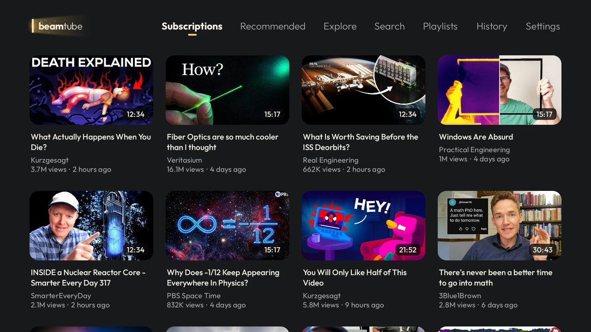
</p>

# BeamTube

**An uncluttered YouTube client for Android phones, tablets and TVs, for people who sit down to watch.**

The official YouTube app is built to keep you scrolling. Shorts in every corner, comments under
everything, notifications, autoplay into whatever is trending. That's fine when you want it. But a
lot of the time you just want to watch the channels you chose, the hour-long documentary you saved
last week, or a quiet playlist to fall asleep to.

BeamTube starts from that side. It opens on your subscriptions, keeps the screen almost empty,
leaves out the things designed to pull you somewhere else, and adds the small tools that make long
videos nicer to watch. One APK runs on your phone, your tablet and your Android TV, and picks the
right interface by itself.

> **BeamTube is an unofficial app.** It is an independent project, not affiliated with, endorsed by
> or sponsored by YouTube or Google. See [Legal](#legal) below.

## Contents

- [How it differs from the official app](#how-it-differs-from-the-official-app)
- [Made for longer videos](#made-for-longer-videos)
- [Falling asleep to videos](#falling-asleep-to-videos)
- [Explore](#explore)
- [Your topics](#your-topics)
- [Subscribe to playlists](#subscribe-to-playlists)
- [On the TV](#on-the-tv)
- [On phones and tablets](#on-phones-and-tablets)
- [Make it yours](#make-it-yours)
- [What's not in BeamTube](#whats-not-in-beamtube)
- [Install](#install)
- [Privacy](#privacy)
- [Building from source](#building-from-source)
- [Legal](#legal)

## How it differs from the official app

| | YouTube app | BeamTube |
| --- | --- | --- |
| **Home screen** | An algorithmic home feed | Your subscriptions, newest first |
| **Shorts** | Everywhere | Nowhere, ever |
| **Comments, live chat, notifications** | Yes | No |
| **Live streams** | Mixed into every feed | Only in search, and in Subscriptions if you turn them on |
| **Titles and audio** | Often auto-translated titles and dubbed audio | Always the original title and the original audio track |
| **Phone, tablet and TV** | Separate apps that look and behave differently | One app, one look, the right layout for each screen |
| **Duration filters** | Under 4, 4 to 20, or over 20 minutes | Also 30, 45 and 60 minutes or more |
| **Older videos** | Hard to find | A "Before 2015" (or any year) filter |
| **Subscribing to a playlist** | Not possible | Yes, new videos show up with your subscriptions |
| **Links from other apps** | Go to your watch history | Play without touching your history (you can change this) |
| **Hiding topics** | "Not interested", one video at a time | Topics you see less of, matched by keywords |
| **When a video ends** | Autoplays whatever comes next | A few suggestions, then back to your list (or your choice) |

## Made for longer videos

Most of what BeamTube adds is about the moment after you press play.

- **Long videos are easy to find.** Search and Explore can filter for 30, 45 or 60 minutes or more,
  and "Before *year*" digs up older videos the algorithm has long forgotten.
- **It remembers where you stopped**, on every device, and picks up from there next time.
- **It jumps over the boring part.** When you skip forward inside a stretch that most viewers skip
  (a sponsor read, a long intro), BeamTube jumps straight to where people start watching again and
  says "Jumped ahead". It uses YouTube's own "most replayed" data, so there's no separate button
  and no third-party service. The start of each of those stretches is marked on the timeline.
- **Chapters** show on the timeline, with the current chapter's name and a thumbnail preview while
  you scrub.
- **Captions you can read.** Always centered, white with a thin outline, and automatic captions
  appear two lines at a time instead of scrolling word by word.
- **Playlists play in order**, so Watch later works as a real queue. You can reorder it by dragging,
  swipe a video to the top, or swipe it away, with Undo.
- **The best picture your screen can show.** On TV the player goes for 4K first and only steps down
  when the TV really can't keep up; phones and tablets start at 1080p. If you pick a resolution by
  hand, it stays.
- **When a video ends,** BeamTube shows a few suggestions (the next video from the list you came
  from, one from the same channel, and related videos that respect your topics), with Back already
  focused on the TV. If you don't pick anything, it takes you back to your list after 15 seconds
  instead of autoplaying the next thing. In Settings you can make it go straight back, play the
  first suggestion, or just stay on the video. Playlists and the sleep mode are left alone.

<p align="center">
  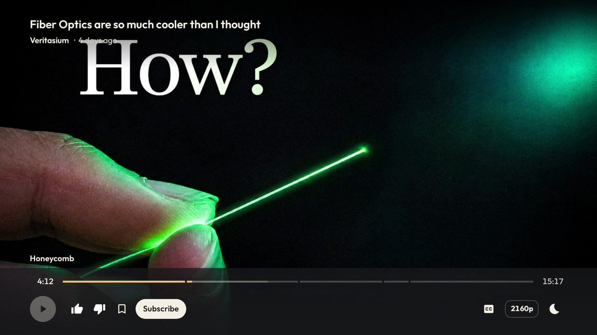
  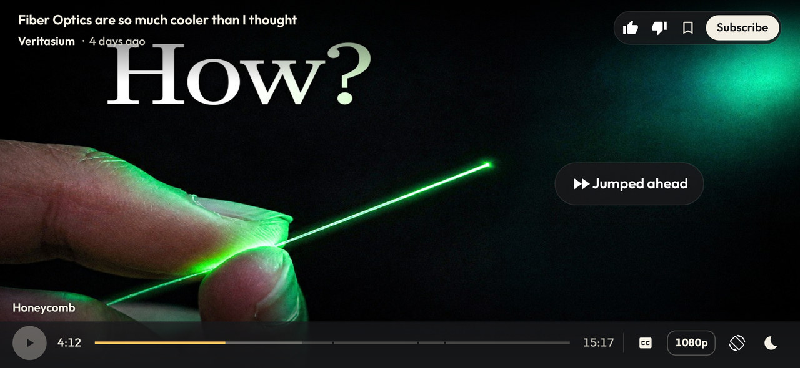
</p>
<p align="center">
  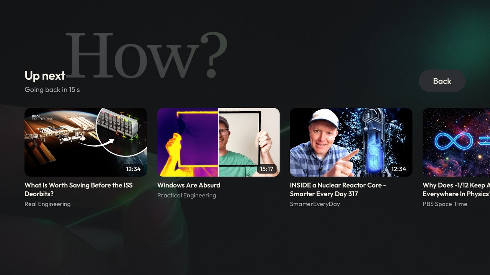
</p>

## Falling asleep to videos

BeamTube grew out of falling asleep to playlists on the TV, so the player has a sleep mode. Tap
the moon:

- **Brightness:** 100, 50, 25, 10 or 0%. The picture and captions dim without touching the TV's own
  brightness, so the room stays dark while the sound keeps going. It stays dimmed for the next
  videos until you close the app.
- **Then play:** how many more videos of the playlist should play after this one, from none to all.
- **When done** (TV only): stay on, or **turn the TV off** when the last video ends. You get ten
  seconds to cancel, then the TV goes to sleep (and with HDMI-CEC, the TV set switches off too).

On a phone, you can switch the screen off and the video keeps playing as audio only, without
downloading the picture, with the usual controls on the lock screen. Leave the app while a video is
playing and it moves into a small floating window.

<p align="center">
  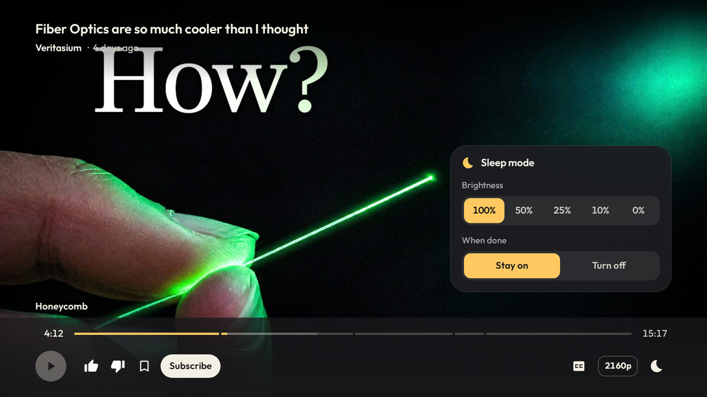
</p>

## Explore

Recommended is still there, if you like it. Explore is a different way to find new things, and it
comes from the people you already trust.

Creators often list other channels they like on their own channel page. Explore reads those lists
from the channels you subscribe to, and shows you videos from about ten of the recommended channels
at a time: a couple of recent ones and a couple of their best-known or favorite older ones. Every
refresh draws a different set of channels. Channels you already follow, channels you blocked and
second channels of creators you follow (translations, podcasts, "2nd channel") are left out, and so
are videos you've already watched.

The date, duration and sort filters work here too, so "60 minutes or more, before 2018" is a
perfectly good way to spend an evening.

<p align="center">
  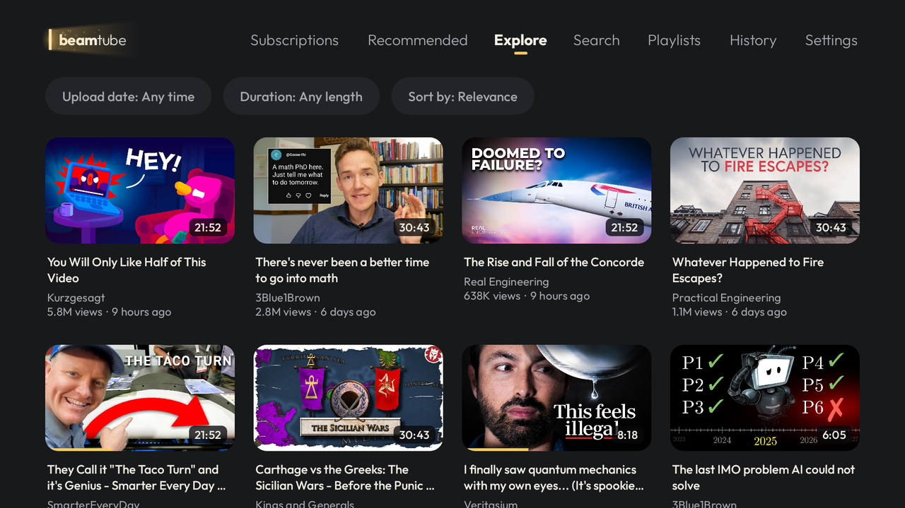
  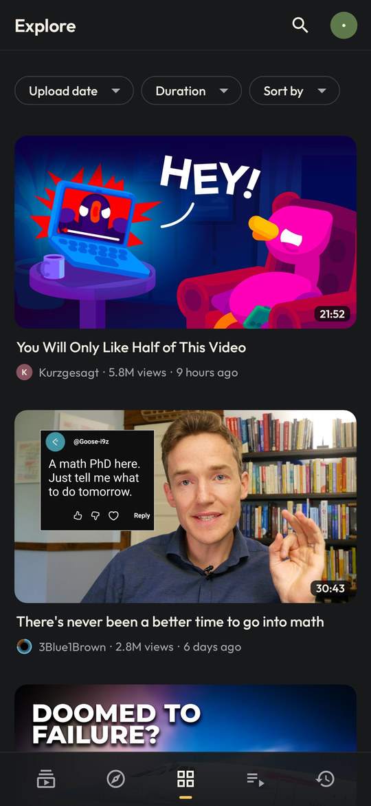
</p>

## Your topics

The first time you open BeamTube, it asks two questions: what you'd like to see more of, and what
you'd like to see less of. Pick from more than 40 suggestions, from documentaries, history and
engineering to sleep and relaxing videos, or from gaming, news and celebrity gossip on the other
side. You can skip it and come back any time in Settings.

- **See more of:** videos about these topics come first in Recommended.
- **See less of:** videos about these topics don't show up in Recommended, in Explore or in videos
  from subscribed playlists.
- **Your subscriptions are never filtered by topic.** You chose those channels.

A topic is just a name and a list of keywords, matched as whole words in the title and the channel
name. In Settings you can change the keywords of any topic or add your own. You can also block a
channel, and it disappears from everywhere.

<p align="center">
  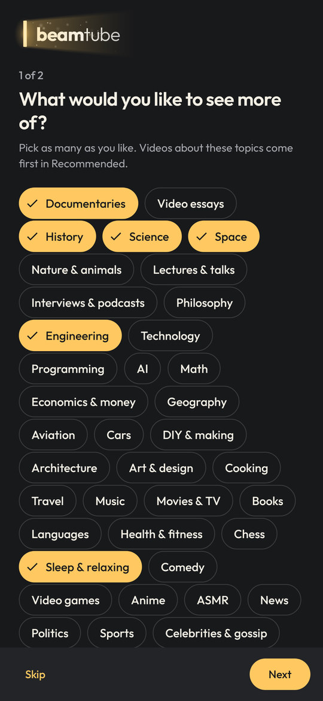
  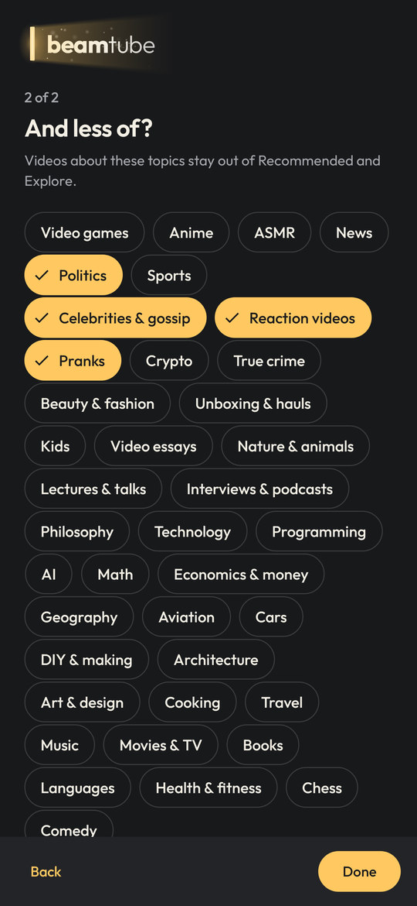
</p>
<p align="center">
  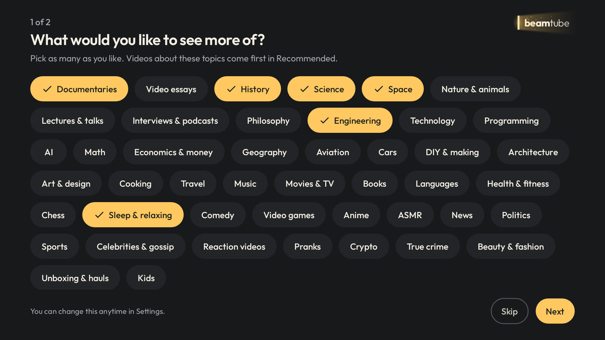
</p>

## Subscribe to playlists

YouTube lets you subscribe to channels, but not to playlists. In BeamTube, open a playlist from any
channel and tap Subscribe. From then on, new videos added to it show up in your Subscriptions feed,
next to the videos from your channels.

The subscription is stored as a saved playlist in your YouTube account, so it's the same on all
your devices. If you already follow the channel, its videos aren't repeated.

## On the TV

- Made for the remote: big cards, clear focus, everything reachable with the D-pad.
- Hold OK on a video for a quick menu: save it, remove it, or go to the channel.
- Sign in by scanning a QR code with your phone.
- **The YouTube button on your remote can open BeamTube.** Turn on BeamTube's Accessibility
  service once, press the button, and the app learns your remote's key by itself.
- Come back after a while and Subscriptions are already refreshed, with the new videos on top.
- Rest the focus on a video for a couple of seconds and BeamTube starts getting it ready, so it
  opens faster when you press OK.

## On phones and tablets

- Double-tap the sides of the video to skip 10 seconds; keep tapping to add more.
- Swipe sideways to switch tabs, pull down to refresh.
- Long-press a thumbnail to save it to Watch later.
- The player turns by itself to fit the video, and a button switches orientation.
- On tablets, three columns in portrait and a side rail in landscape.

<p align="center">
  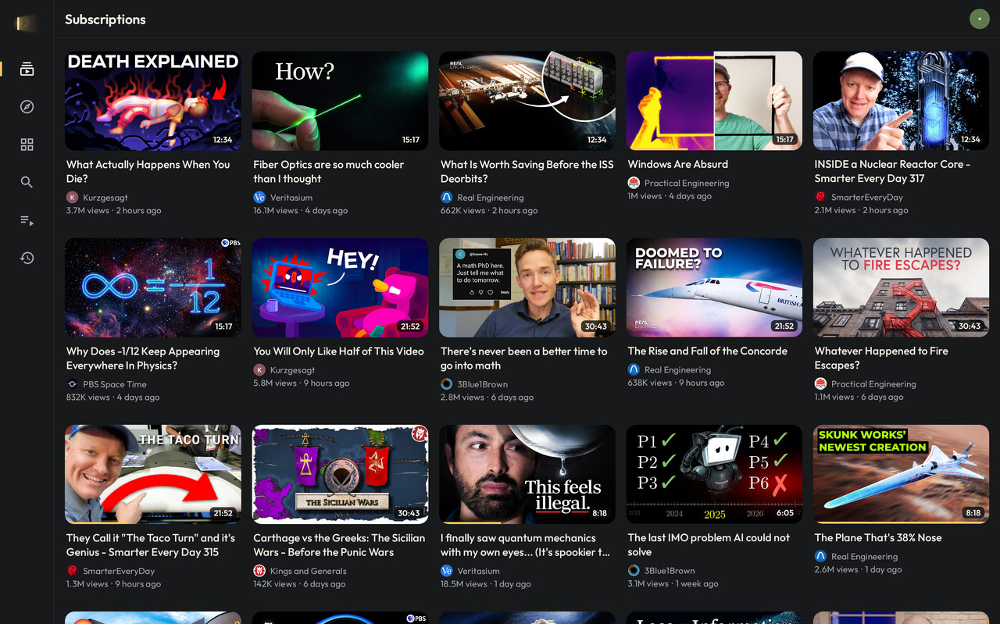
</p>
<p align="center">
  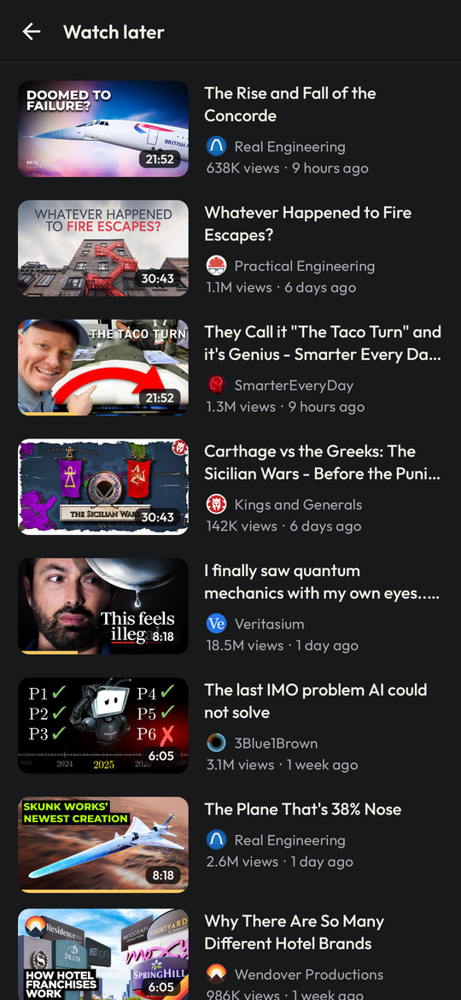
  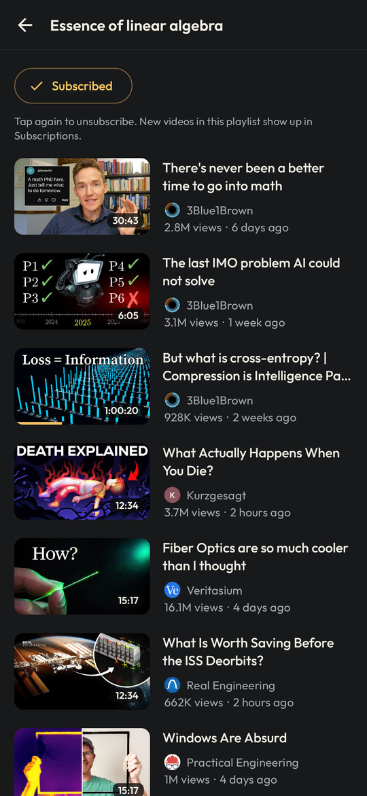
  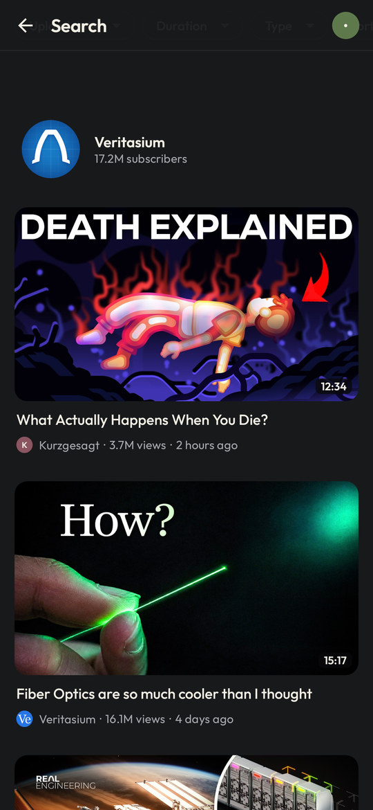
</p>

## Make it yours

- **Seven icon colors** and **seven highlight colors** in Settings. The highlight color is used for
  the open tab, progress bars, focus on TV and the player.
- **English, Portuguese and Spanish.** BeamTube follows your device's language, or you can pick one
  in Settings > Language.

<p align="center">
  
  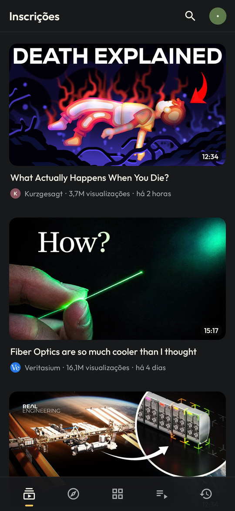
  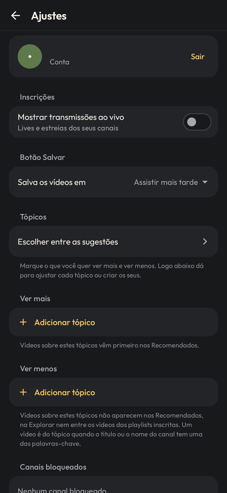
</p>
<p align="center">
  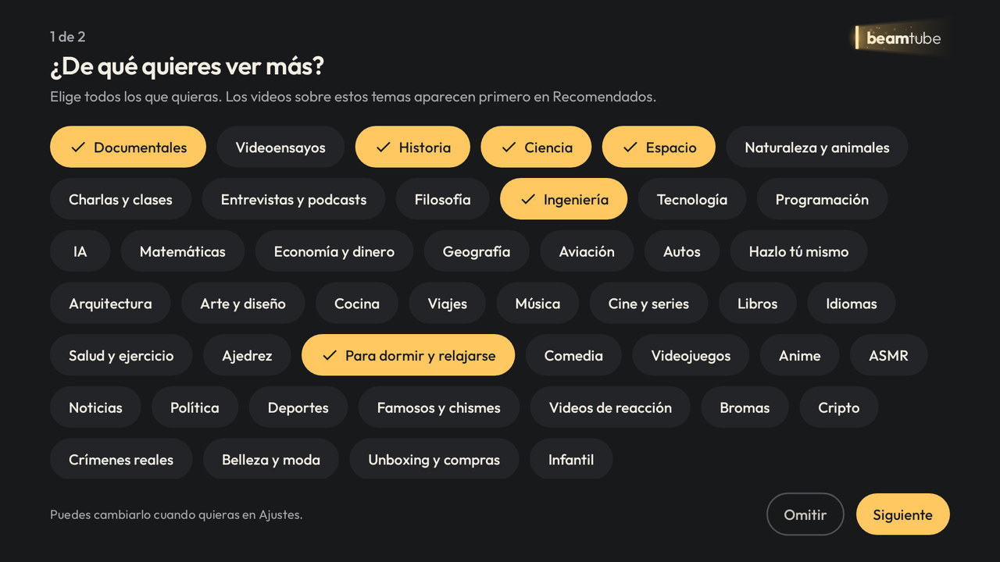
</p>

## What's not in BeamTube

On purpose: Shorts, comments, live chat, notifications, uploads, the Trending and Shopping
sections, and most buttons. You can like, dislike, save and subscribe, and that's it. If you need
the rest, the official app is still there.

## Install

BeamTube needs Android 6.0 or newer, on an ARM device (that's nearly every phone, tablet and
Android TV).

1. Download `beamtube-X.Y.Z.apk` from the latest [release](https://github.com/JohanKRS/beamtube/releases/latest)
   and install it. On a TV, a file manager or the "Downloader" app makes this easier.
2. Open BeamTube and sign in with the code on [youtube.com/activate](https://youtube.com/activate)
   (on TV, scan the QR code). You sign in on Google's own page; BeamTube never sees your password.

**Updates:** with [Obtainium](https://github.com/ImranR98/Obtainium), add
`https://github.com/JohanKRS/beamtube` and BeamTube updates itself from the releases here.

**Open YouTube links in BeamTube** (Android 12 and newer): in the system settings, open the YouTube
app's "Open by default" page and turn off "Open supported links", then open BeamTube's page and add
youtube.com, m.youtube.com and youtu.be.

**Turn the TV off at the end, and the remote's YouTube button** need BeamTube's Accessibility
service: Settings > Accessibility > BeamTube. The service only puts the device to sleep and listens
for the remote's YouTube button; it doesn't read the screen. On Android 13 and newer, an app
installed outside the Play Store may need "Allow restricted settings" first (App info > ⋮).

**Coming from Doorglow?** That was BeamTube's name before 1.0. BeamTube installs as a separate app:
add it to Obtainium again, sign in, pick your topics, and then uninstall Doorglow.

## Privacy

- BeamTube has no servers, no ads, no analytics and no crash reporting of its own. It sends
  nothing to its developer.
- The app talks to YouTube and Google to sign you in, load your lists and play videos, like any
  YouTube client.
- Your topics, blocked channels, watch positions and settings stay on your device. Signing out
  deletes the lists cached on it.
- Videos opened from links in other apps aren't added to your watch history, unless you choose
  otherwise.

## Building from source

BeamTube is written in Kotlin with Jetpack Compose (Compose for TV on TV) and plays video with
Media3/ExoPlayer. Sign-in, feeds, playlists and streams come from
[MediaServiceCore](https://github.com/yuliskov/MediaServiceCore), the engine behind
[SmartTube](https://github.com/yuliskov/SmartTube), used unchanged as a git submodule.

```sh
git clone --recursive https://github.com/JohanKRS/beamtube.git
cd beamtube
./gradlew :app:assembleAppDebug
```

You need JDK 17 or newer and the Android SDK (compile SDK 36). The unit tests run with
`./gradlew :app:testAppDebugUnitTest`.

## Legal

**License.** BeamTube's own code is released under the [MIT License](LICENSE). It ships with
open-source software from other people under their own licenses (MIT, Apache 2.0, BSD, EPL 1.0,
CC0 and the SIL Open Font License), listed in [THIRD_PARTY_NOTICES.md](THIRD_PARTY_NOTICES.md),
with the full texts in [licenses/](licenses/). The BeamTube name and logo are not covered by the
MIT License.

**Not affiliated with YouTube or Google.** BeamTube is an independent, unofficial client. It is not
affiliated with, endorsed by, sponsored by or approved by YouTube or Google LLC. YouTube, Android,
Android TV and Google TV are trademarks of Google LLC, used here only to say what BeamTube works
with.

**No warranty.** BeamTube is provided "as is", without warranty of any kind, as the license says.
It depends on how YouTube works today, and YouTube can change that at any time, so things may
break. You use it with your own Google account and at your own risk, and you are responsible for
following YouTube's Terms of Service.

**Content.** All videos, thumbnails, titles and channel names belong to their creators. The
screenshots in this README show public videos from Kurzgesagt, Veritasium, 3Blue1Brown, Real
Engineering, Practical Engineering, Wendover Productions, SmarterEveryDay, PBS Space Time and Kings
and Generals, used only to show the app. BeamTube doesn't download, store or redistribute videos.
